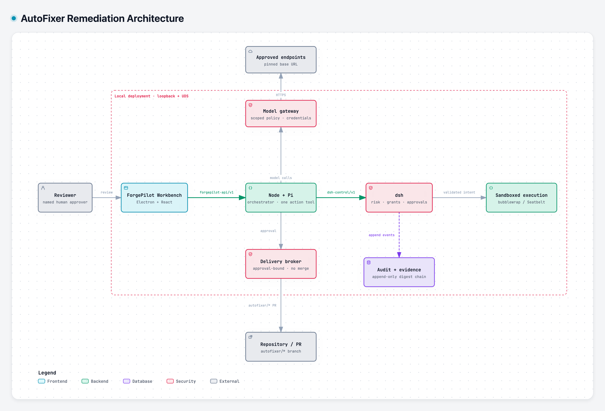

<div align="center">


<h1>AutoFixer</h1>

<p><strong>Least-privilege remediation for repositories that cannot bypass review.</strong></p>

<p>AutoFixer turns a reported problem into an auditable, human-approved change —
without giving the agent shell access, credentials, or merge authority.</p>

<p>
  <a href="LICENSE"></a>
  
  
  
</p>

<p>
  <a href="#quick-start">Quick start</a> ·
  <a href="#how-it-works">How it works</a> ·
  <a href="#security-model">Security model</a> ·
  <a href="#documentation">Documentation</a>
</p>

</div>

> [!NOTE]
> AutoFixer is pre-1.0. The execution authority and the contracts in
> [`docs/contracts`](docs/contracts) are stable within their declared versions;
> deployment and tenant surfaces are still evolving. See
> [Project status](#project-status).

AutoFixer is the open-source codebase behind **ForgePilot**, a local-first
remediation workbench for governed repositories. A remediation run is a
bounded attempt to diagnose one reported problem and prepare a proposed change
under a task-specific capability grant. The run may inspect an approved
checkout, execute allow-listed diagnostic tools, and prepare a patch. It may
not write to `main`, read secrets, change CI or repository governance, or merge
anything.

## Why AutoFixer

Coding agents usually become useful by accumulating access: a shell, a
filesystem, credentials, a network, a push token. Each addition makes the
agent harder to review and the blast radius harder to bound.

AutoFixer starts from the opposite assumption. The agent is untrusted, the
repository is governed, and every action must be granted, checked, and
provable. A reviewer should be able to accept a change from its evidence
rather than from the agent's confidence.

## What you get

| Capability | What it means |
| --- | --- |
| **Bounded remediation runs** | Every run names its repository, pinned base SHA, allowed paths, tool identities, network destinations, wall clock, and resource limits. Missing scope means denied. |
| **Two independent gates** | The tool registry allow-list and dsh's capability grant must both approve a dispatch. A denied intent is returned to the model and recorded; neither gate trusts the other. |
| **Human approval before delivery** | A candidate is frozen with its summary, diff, and validation evidence. A human approves that exact head; only then does the delivery broker open an `autofixer/*` pull request. |
| **Evidence, not logs** | State transitions and tool calls append to an immutable evidence chain bound to the head SHA. Every terminal outcome — completion, refusal, denial, cancellation, or timeout — leaves a bundle. |
| **Governed workspace memory** | Evidence-cited lessons, versioned governance, scoped retrieval, and enterprise templates inform later runs without granting authority. Bounded RSI adds holdout evaluation, canaries, rollback, and a kill switch. |
| **Fail-closed model egress** | Pi reaches models only through the Node gateway. Provider credentials stay outside the agent, policies are scoped per enterprise and workspace, and missing configuration denies egress instead of falling back. |

The Electron/React workbench adds issue intake, candidate review, delivery
status, workspace and team administration, security cases, cost and trace
views, and memory/RSI governance. Browser sessions use an HttpOnly cookie with
CSRF protection; desktop tokens stay in the Electron main process and never
enter renderer JavaScript.

## How it works

<p align="center">
  <a href="docs/assets/autofixer-architecture-light.png">
    <picture>
      <source media="(prefers-color-scheme: dark)" srcset="docs/assets/autofixer-architecture-dark.png">
      
    </picture>
  </a>
</p>

<p align="center"><sub>The workbench and orchestrator never hold merge authority. dsh executes only within the run's grant; the broker can only propose a pull request.</sub></p>

1. **Intake.** A task names the repository, a pinned base SHA, the issue, and
   the requested scope.
2. **Risk and grant.** dsh classifies the risk and issues a capability grant:
   permitted paths, tools and arguments, network destinations, duration, and
   resource limits. Prohibited work is rejected, not downgraded.
3. **Bounded execution.** Pi's only action tool is `dsh_request_action`, which
   forwards a structured intent; its other tool only records a turn summary and
   executes nothing. dsh re-checks every intent against the grant and runs
   approved tools inside the OS sandbox. Pi has no shell, file-edit, or network
   capability of its own.
4. **Candidate freeze.** The proposed change is frozen with a summary, diff,
   and test evidence. The review card is bound to the exact head SHA.
5. **Human approval and delivery.** A human approves the frozen candidate. The
   delivery broker then creates or updates an `autofixer/*` pull request. The
   agent cannot approve, merge, or enqueue it.
6. **Evidence.** Approvals, validations, and delivery operations append to the
   audit chain. A missing or malformed record blocks review and delivery.

## Quick start

### Prerequisites

| Tool | Version | Needed for |
| --- | --- | --- |
| [Go](https://go.dev/dl/) | 1.25+ | CLI, dsh authority, Go packages |
| [Node.js](https://nodejs.org/) | 20.11+ | Node/Pi orchestrator, Electron workbench |
| Sandbox backend | `bubblewrap` on Linux; `sandbox-exec` on macOS | Isolated tool execution |

Linux with bubblewrap provides a complete process domain: the PID namespace
owns every descendant and removes the domain when it ends. The macOS Seatbelt
backend confines filesystem, network, and credential access, but cannot
guarantee that every descendant is reaped; the runner therefore refuses
untrusted execution on macOS rather than claim supervision it cannot provide.

### Run the golden task

```sh
git clone https://github.com/FoMo-Exp/AutoFixer.git
cd AutoFixer
go run ./cmd/autofixer demo
```

The offline fixture dispatches one allow-listed `echo hello` action and emits
an evidence bundle. Expected output begins:

```text
outcome: completed
terminal_state: stopped
code: stop_local_review_required
reason: task completed locally; no pull request is bound, human disposition required
patch_status: not_created
exit_code: 0
```

`stopped` here means the run completed locally and is waiting for human
disposition; it is not a failure. The CLI exit code is `0`.

Run the same composition against any controlled task input:

```sh
go run ./cmd/autofixer run \
  --input cmd/autofixer/testdata/golden-task.json \
  --format json
```

See the [prototype demo guide](docs/prototype-demo.md) for the task-input
shape, exit codes, and the evidence fields each narrative produces.

### Run the full workbench

dsh exposes only a local Unix socket or Windows named pipe and refuses to start
without an explicit approver identity.

```sh
# 1. dsh execution authority (local transport only; no TCP listener)
go run ./cmd/autofixer dsh serve \
  --socket /tmp/autofixer-dsh.sock \
  --approver github:local-operator

# 2. Build the orchestrator and workbench
(cd node && npm install && npm run build)
(cd web && npm install && npm run build)

# 3. Launch the desktop workbench; it starts the local Node service
cd web
FORGEPILOT_BASE_SHA=$(git rev-parse HEAD) \
FORGEPILOT_DSH_SOCKET=/tmp/autofixer-dsh.sock \
npm start
```

Model calls additionally require a scoped gateway policy and credentials file
(`FORGEPILOT_GATEWAY_POLICY_FILE`, `FORGEPILOT_GATEWAY_CREDENTIALS_FILE`).
Without them, model egress is denied by design. Configuration and OAuth setup
are documented in [node/README.md](node/README.md#running) and
[web/README.md](web/README.md).

## Security model

The agent is not the authority. dsh is the fact source for risk, grants,
execution, and evidence; Node may persist projections only.

| Boundary | Enforced by |
| --- | --- |
| Which actions are allowed | Per-run capability grant; deny by default; missing scope means denied |
| Which tool may run | Independent registry allow-list and harness grant, both checked before dispatch |
| What the process can reach | OS sandbox: network denied, writes confined, credential paths hidden |
| Which model endpoint is used | One fail-closed gateway; policies and credentials are deployment files, never agent inputs |
| Whether a PR may exist | Frozen candidate plus head-bound human approval; broker opens only `autofixer/*` branches |
| Who may merge | The repository's merge queue; AutoFixer has no merge or enqueue authority |
| What is provable | Append-only events, digest-linked evidence, and head-SHA binding; missing evidence blocks delivery |

AutoFixer will not:

- push to `main` or alter branch protection;
- dismiss reviews, change required checks, self-approve, or enqueue a pull
  request;
- read or write repository secrets, cloud credentials, or CI configuration;
- publish packages, deploy, or change infrastructure;
- widen its own grant or retry a stopped run without a new human decision.

The full governance and threat model, including the considered alternatives,
is [ADR-0001](docs/adr/0001-forgepilot-governance-and-threat-model.md).

## Repository layout

| Path | Role |
| --- | --- |
| `cmd/autofixer` | Go CLI: `demo`, `run`, and `dsh serve` |
| `dsh` | Local control plane for risk, grants, approvals, execution, and audit |
| `harness`, `sandbox`, `delivery` | Policy and grant evaluation, OS-level isolation, evidence bundles |
| `agent` | Deterministic planner, tool registry, run loop, session, and event timeline |
| `node` | TypeScript/Pi orchestrator, product API, gateway, memory, RSI, security |
| `web` | Electron + React operator workbench |
| `docs` | ADRs, versioned contracts, fixtures, and the demo guide |

## Documentation

| Document | Contents |
| --- | --- |
| [CONTEXT.md](CONTEXT.md) | Normative product vocabulary: remediation run, capability grant, stop condition, lesson, RSI |
| [Prototype demo guide](docs/prototype-demo.md) | Golden task, refusal paths, exit codes, evidence structure |
| [Task evidence contract](docs/contracts/task-evidence-contract-v1.md) | Versioned record shape for runs and evidence |
| [dsh control contract](docs/contracts/dsh-control-v1.md) | Local Node-to-dsh protocol |
| [Product API contract](docs/contracts/forgepilot-api-v1.md) | UI-to-Node API, errors, idempotency, workspace scope |
| [Architecture decisions](docs/adr) | Governance, prototype composition, Pi orchestration, credentials, egress, memory |
| [Node orchestrator](node/README.md) | Authority boundary, gateway, budgets, authentication, durability |
| [Workbench](web/README.md) | Issue, candidate review, security, memory, RSI, and settings surfaces |

## Development

Enable the repository hook once per clone:

```sh
git config core.hooksPath .githooks
```

| Layer | Check |
| --- | --- |
| Go CLI, dsh, packages | `go test ./...` |
| Node orchestrator | `cd node && npm install && npm run typecheck && npm run lint && npm run format:check && npm test` |
| Electron/React workbench | `cd web && npm install && npm run typecheck && npm run lint && npm run format:check && npm test && npm run build` |

The Node integration tests build the Go binary and start a private `dsh serve`
on a temporary UDS, so the Go toolchain must remain on `PATH`. Only the model
stream is scripted; the agent loop, tool validation, control plane, grants,
sandbox, stop conditions, and timeouts are the real implementations.

Contracts in [`docs/contracts`](docs/contracts) are normative and versioned. A
breaking change needs a new contract version and an ADR in
[`docs/adr`](docs/adr). Product wording follows [`CONTEXT.md`](CONTEXT.md):
prefer *remediation run*, *capability grant*, *change approval*, and *stop
condition*; avoid *autonomous deployment* and *unattended fix*. Contributors
changing `web/` should also read [`AGENTS.md`](AGENTS.md) for the visual and
accessibility baseline.

## Project status

AutoFixer is an active prototype, not a turnkey hosted service.

- **Stable core.** The Go dsh authority, sandbox, evidence contract, and
  Node-to-dsh protocol are exercised by unit and integration tests.
- **Pilot scope.** The default deployment targets one repository
  (`github:Luthiel/AutoFixer`). Enterprise, workspace, team, and invitation
  surfaces exist in the Node service and workbench, but multi-tenant
  operations are still evolving.
- **Platform limits.** Complete execution isolation is currently available on
  Linux with bubblewrap. The macOS Seatbelt backend is best-effort for process
  supervision and refuses untrusted execution.
- **No merge authority.** Even in a fully configured deployment, AutoFixer can
  only propose a pull request. Repository protection and the merge queue remain
  the final authority.

Work is tracked in the repository's issues. There is no promised release
schedule.

## Contributing

Issues and pull requests are welcome. Before opening a pull request:

1. Read [`CONTEXT.md`](CONTEXT.md) and the ADRs that cover the area you are
   changing.
2. Keep the change inside one governed seam. Do not add an ambient credential,
   a bypass around dsh, or a path that lets the agent grant itself authority.
3. Run the checks for every package you touched and include the commands and
   results in the pull request.
4. Describe the evidence: what changed, why, and how it was verified.

Please do not disclose suspected vulnerabilities in a public issue. Report
them privately to the maintainers through GitHub's private vulnerability
reporting for this repository.

## License

[MIT](LICENSE) © 2026 Luthiel
